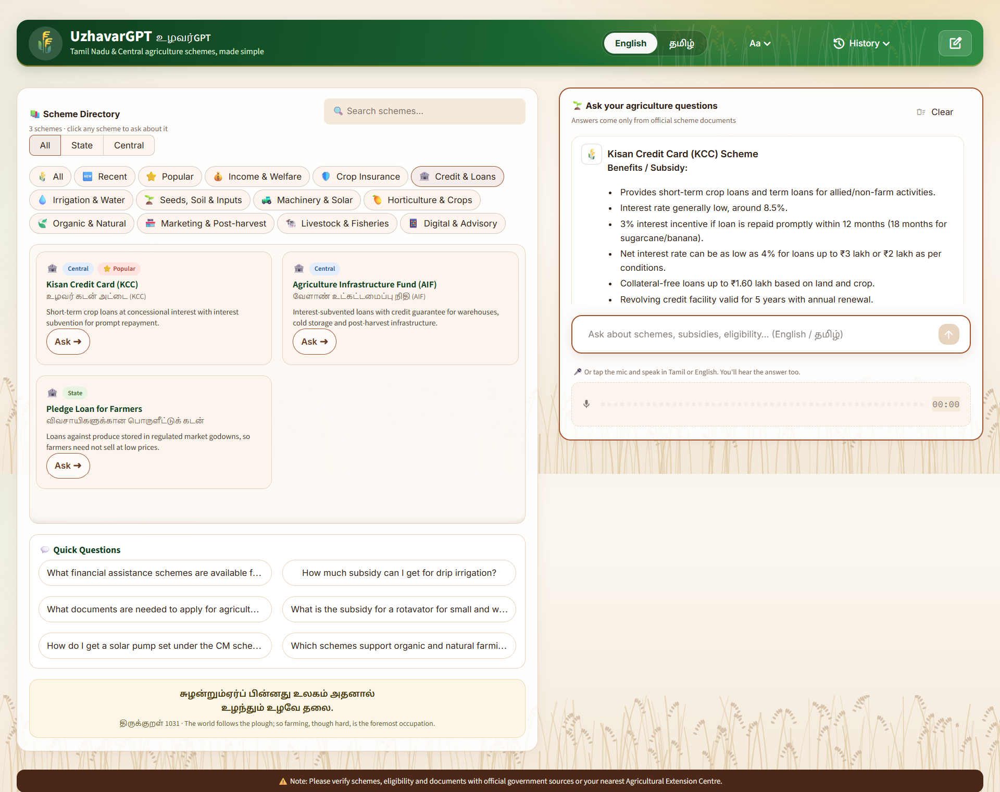
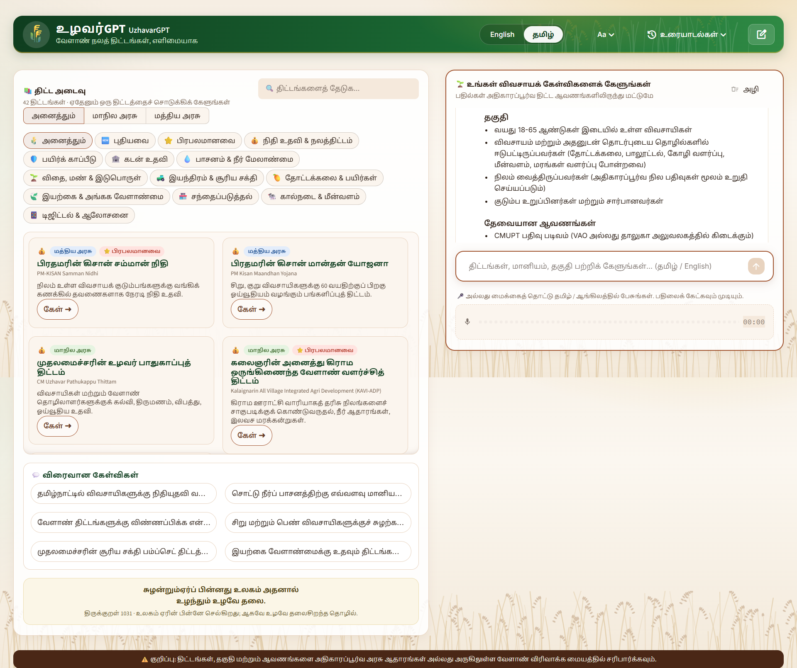

# 🌾 UzhavarGPT (உழவர்GPT)


A bilingual (English / தமிழ்) AI assistant that helps farmers in Tamil Nadu find and understand
**Tamil Nadu State and Central government agriculture schemes**: subsidies, eligibility, required documents and how to apply.

Answers are generated only from a curated knowledge base of official documents, stored in a local FAISS vector index.
The application makes no web searches at runtime.

## Demo

### English

https://github.com/user-attachments/assets/75b7b6fc-fba8-48a1-8060-8c3a38eb3219

### தமிழ் (Tamil)

https://github.com/user-attachments/assets/940cac27-cc3c-43d6-9863-d31a0f40961e

## Screenshots

**English:** scheme directory filtered by *Credit & Loans*, with a Kisan Credit Card answer



**தமிழ் (Tamil):** full Tamil interface, with a scheme answer in Tamil



## Features
- **Scheme directory**: 42 schemes, filterable by category, State / Central, 🆕 Recent and ⭐ Popular, with search
- **Click-to-ask** scheme cards and quick questions
- **Bilingual**: English / Tamil interface; answers follow the language of the question
- **Voice**: ask by voice in Tamil or English and get both a text and a spoken reply
- **Source citations** on every answer
- Adjustable text size, new chat, clear and chat history

## Architecture
```
Streamlit UI (app.py) ──HTTP──▶ FastAPI backend (api.py)
                                 ├─ GET  /schemes     scheme directory
                                 ├─ POST /chat        query rewrite ─▶ FAISS top-k ─▶ LLM (streamed)
                                 ├─ POST /transcribe  speech ─▶ text
                                 ├─ POST /speak       text ─▶ speech (Tamil / English)
                                 └─ GET  /health
```
| Layer | Technology |
|---|---|
| Frontend | Streamlit |
| Backend | FastAPI, Uvicorn |
| RAG | LangChain, FAISS |
| Models | OpenAI `gpt-4.1-mini`, `text-embedding-3-small`, `gpt-4o-mini-transcribe`, `gpt-4o-mini-tts` |
| Observability | LangSmith (optional) |

## Getting started
```bash
python -m venv .venv && .venv\Scripts\activate      # macOS/Linux: source .venv/bin/activate
pip install -r requirements.txt
copy .env.example .env                               # macOS/Linux: cp; then set OPENAI_API_KEY

uvicorn api:app --port 8000                          # terminal 1: backend (API docs: http://localhost:8000/docs)
streamlit run app.py                                 # terminal 2: UI at http://localhost:8501
```
The prebuilt index in `faiss_index/` is included, so no data processing is needed to run the app.

## Data pipeline
The knowledge base was built offline from official sources (full list with links: [source-data/SOURCES.md](source-data/SOURCES.md)):
- Tamil Nadu Agriculture - Farmers Welfare Department **Policy Note 2026-27**
- ICAR-SBI **"Tamil Nadu Agricultural Schemes Made Simple"**, Vol I (Central) and Vol II (State)
- Scheme data from the **TNAGRISNET** and **tn.gov.in** government portals

Scripts used, to reproduce or refresh the data:
```bash
python scrape_schemes.py      # collect scheme data from the official portals into source-data/
python ingest.py              # parse, chunk and embed source-data/ into faiss_index/
python ingest.py --dry-run    # parse and chunk only (no API calls)
```

## Project structure
```
app.py                 Streamlit UI
api.py                 FastAPI backend
rag.py                 retrieval and answer generation
voice.py               speech-to-text and text-to-speech
config.py              models, paths, settings (overridable via .env)
ingest.py              builds the FAISS index
scrape_schemes.py      collects portal data
schemes_catalog.json   scheme directory shown in the UI
source-data/           original documents and collected data
screenshots/           README screenshots
faiss_index/           prebuilt vector index
```

## Configuration
Set in `.env` (see `.env.example`): `OPENAI_API_KEY` (required), optional LangSmith tracing keys,
and optional model overrides such as `STT_MODEL=gpt-4o-transcribe` for higher transcription accuracy.

---
*Disclaimer: scheme details can change. Always verify with official sources or your nearest Agricultural Extension Centre.*
